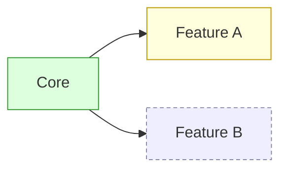

# Map: <project>

The whole project at a glance. Nodes are systems or features, not single
changes; edges mean "builds on". Updated at the end of each Vibe iteration.

| Node | State | Local document |
|------|-------|----------------|
| Core | done | — |
| Feature A | wip | `.sdlc/vibe/feature-a.md` |
| Feature B | idea | — |
