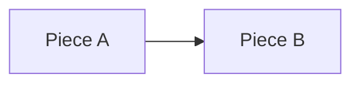

# Vibe: <topic>

- **Map node**: <node in `.sdlc/map.md`>
- **State**: wip | done | dropped | promoted to `.sdlc/<slug>/`
- **Started**: <YYYY-MM-DD>

## Goal, in the user's words

<Verbatim. What we want to see.>

## Pieces being touched

## Done and left

- [ ] <next visible step>

## Log

One line per iteration: what was tried, what was seen, what stays.

| Date | Tried | Seen | Stays |
|------|-------|------|-------|
